# Parcial Práctico 2FA – Desarrollo Web

**Universidad Tecnológica de Panamá – Facultad de Ingeniería en Sistemas**
Período: II Semestre 2026 · Asignatura: Desarrollo Web

**Estudiantes:** Elizabeth Acevedo y Ambar Greco  
**Grupo:** 1S3122  
**Fecha:** 24 de noviembre de 2026  
**Contacto:** elizabeth.acevedo@utp.ac.pa

## Descripción
Sistema de **registro e inicio de sesión con autenticación de dos factores (2FA)** hecho en PHP + MySQL.
Al registrarse, el usuario recibe un **código QR** que escanea con Google Authenticator; al iniciar sesión, después de la contraseña, se le solicita el código de 6 dígitos antes de entrar al sistema.

## Lenguajes y herramientas utilizadas

**Lenguajes**
- PHP 8 (programación orientada a objetos, PDO)
- JavaScript (validaciones en el frontend y consultas AJAX con `fetch`)
- SQL (MySQL)
- HTML5 y CSS3

**Herramientas y librerías**
| Herramienta | Uso |
|---|---|
| WampServer | Servidor local (Apache, PHP y MySQL) |
| phpMyAdmin | Administración de la base de datos y creación de usuarios con privilegios mínimos |
| Visual Studio Code | Editor de código |
| Composer | Gestor de dependencias de PHP |
| `sonata-project/google-authenticator` | Generación y verificación de códigos TOTP (2FA) |
| TCPDF | Generación local del código QR |
| Google Authenticator | Aplicación móvil para escanear el QR y generar los códigos |
| Git y GitHub | Control de versiones y repositorio |

## Instalación
1. Copiar la carpeta del proyecto a `C:\wamp64\www\`.
2. Importar `sql/database.sql` en phpMyAdmin (crea la base `company_info`, las tablas `usuarios` e `intentos_login` y los usuarios de BD con privilegios mínimos).
3. Verificar que las contraseñas de `clases/config.php` coincidan con las del SQL.
4. Abrir `http://localhost/<carpeta>/registro.php`.

## Estructura principal
| Archivo | Función |
|---|---|
| `registro.php` | Formulario de registro con validaciones |
| `verificar_usuario.php` | Validación AJAX de usuario/correo duplicado |
| `clases/RegistroUsuario.php` | Clase del formulario de registro |
| `clases/SanitizarEntrada.php` | Métodos estáticos de sanitización |
| `clases/IHash.php`, `clases/HashBcrypt.php` | Interfaz y clase para generar/validar hash |
| `clases/Csrf.php` | Protección Anti-CSRF |
| `activar_2fa.php` | Muestra el QR y confirma el código |
| `verificar_2fa.php` | Solicita el código 2FA tras el login |
| `privilegios.php` | Muestra los privilegios de los usuarios de BD |
| `sql/database.sql` | Estructura de BD y usuarios con privilegios mínimos |
| `css/auth.css` | Estilos de login, registro y 2FA |

---

# Evidencias según la rúbrica

## 1. Usuarios con privilegios mínimos (15 pts)
No se utiliza el súper usuario `root`. Se crearon `app_login` (SELECT, INSERT, UPDATE) y `app_lectura` (solo SELECT). Comando para ver los privilegios: `SHOW GRANTS FOR 'app_login'@'localhost';`

Código de la pantalla que ejecuta `SHOW GRANTS`:
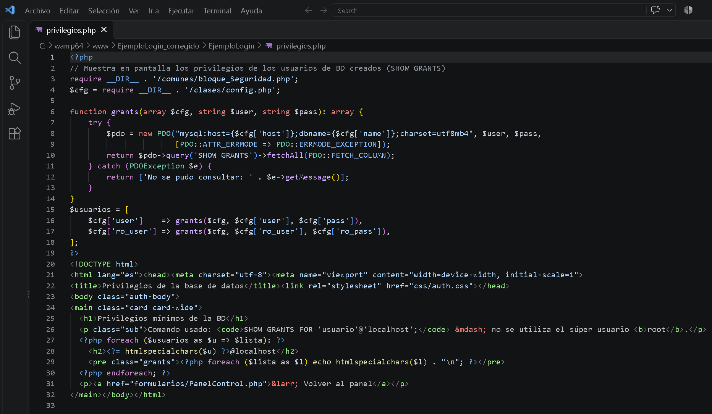

Pantalla con los privilegios concedidos:
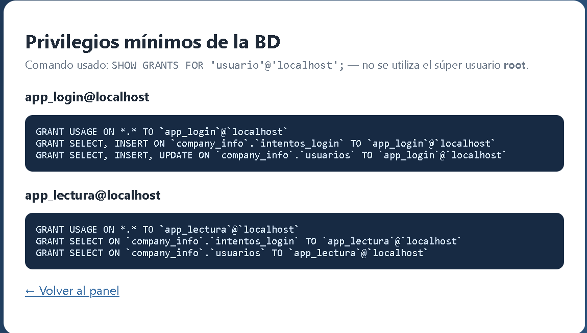

## 2. Formulario de registro con validaciones básicas (5 pts)
Campos requeridos, usuario mínimo de 4 caracteres, correo válido, contraseña mínima de 8 caracteres y confirmación de contraseña.
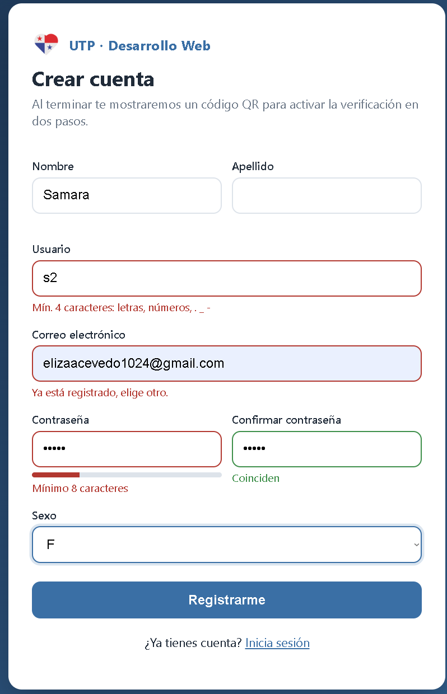

## 3. Validación de correo y usuario duplicados (5 pts)
Se valida en el frontend, en tiempo real (AJAX): en la captura anterior el correo ya existente aparece como *«Ya está registrado, elige otro»*; con datos nuevos aparece *«Disponible»*.
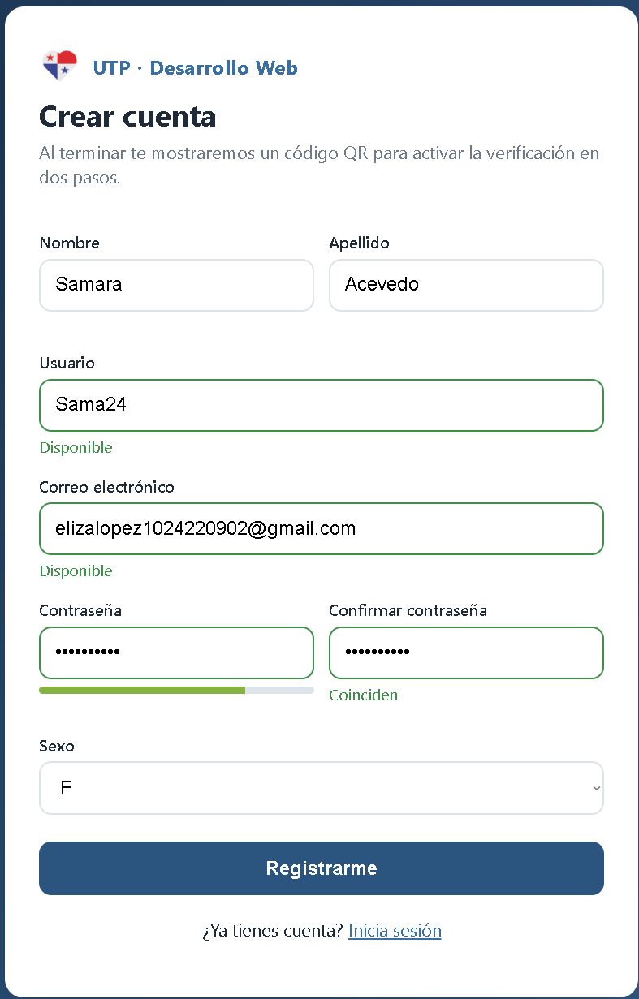

## 4. Clase para el formulario de registro (10 pts)
`RegistroUsuario` con métodos de una sola responsabilidad: `sanitizar()`, `validarCampos()`, `validarDuplicados()`, `guardar()` y `registrar()`.
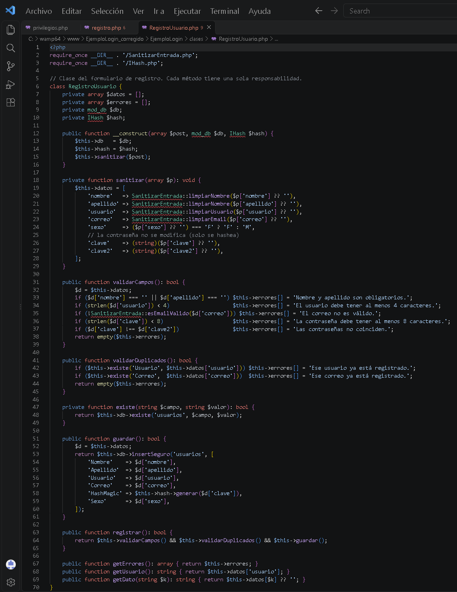

## 5. Sanitización de datos (10 pts)
Clase `SanitizarEntrada` con 7 métodos estáticos: `limpiarCadena`, `limpiarNombre`, `limpiarEmail`, `limpiarUsuario`, `limpiarEntero`, `escaparHtml` y `esEmailValido`.
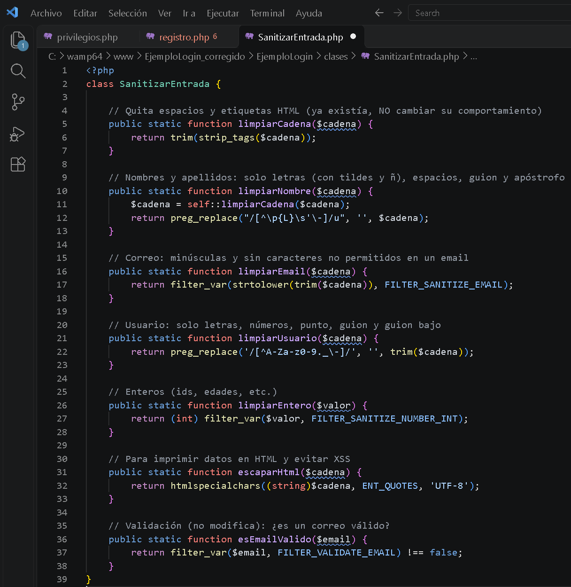

## 6. Generación del código QR (5 pts)
El QR se genera de forma local (TCPDF) justo después de crear el registro; el secreto no sale del servidor.
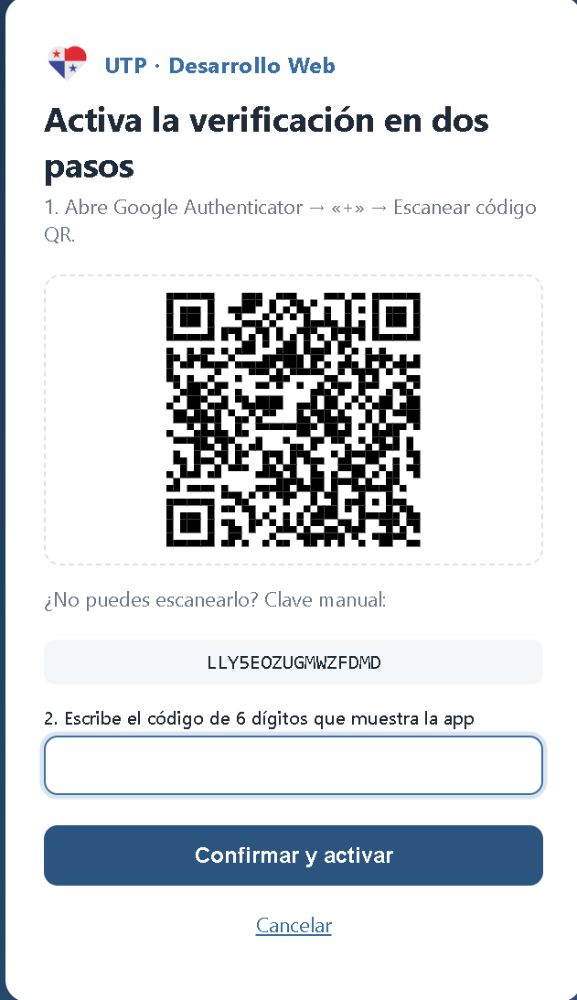

## 7. Inicio de sesión y solicitud del código antes de entrar (5 pts)
Tras activar el 2FA el usuario inicia sesión con su contraseña…
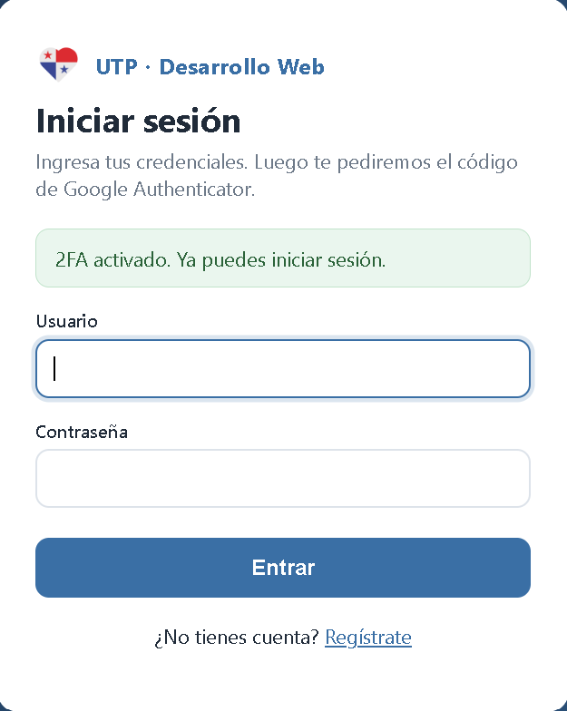

…y antes de entrar se le solicita el código de Google Authenticator:
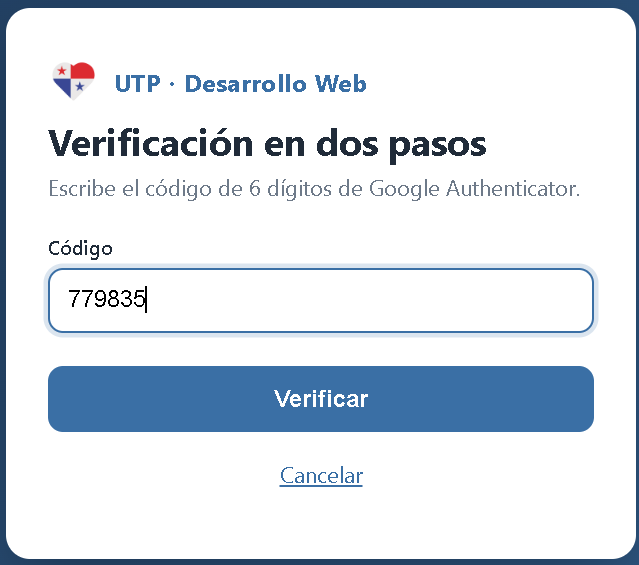

## 8. Otra sesión que confirma que la fase del código fue exitosa (5 pts)
Con el código correcto se regenera el ID de sesión (`session_regenerate_id`) y se crea `$_SESSION['2fa_verificado']`; el panel exige esa variable para permitir el acceso.
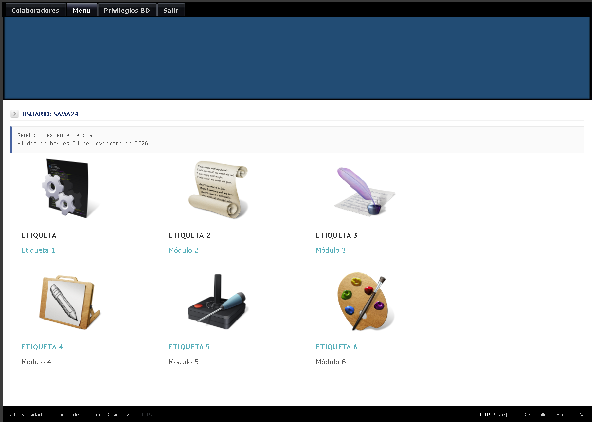
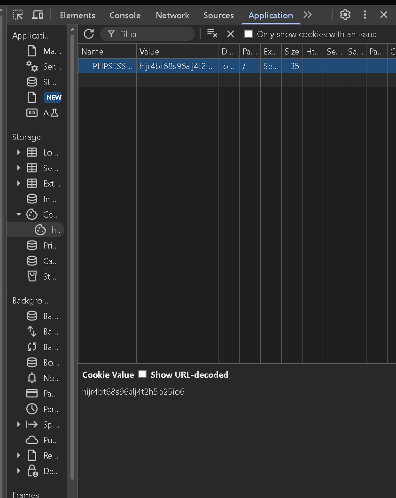

## 9. Interfaz para generar y validar el hash – POO (5 pts)
Interfaz `IHash` implementada por la clase `HashBcrypt`.
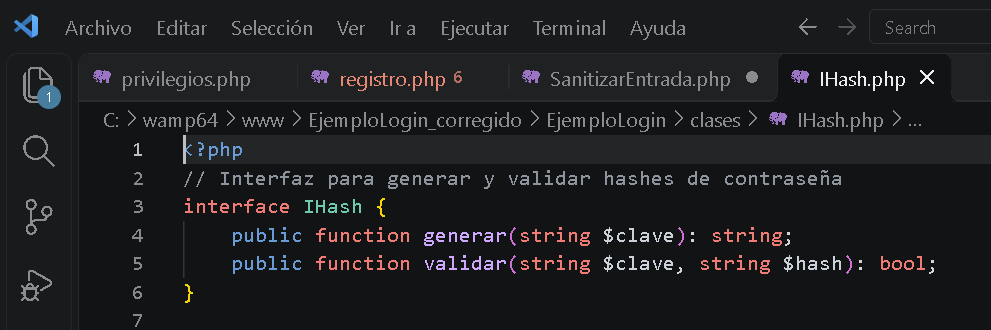
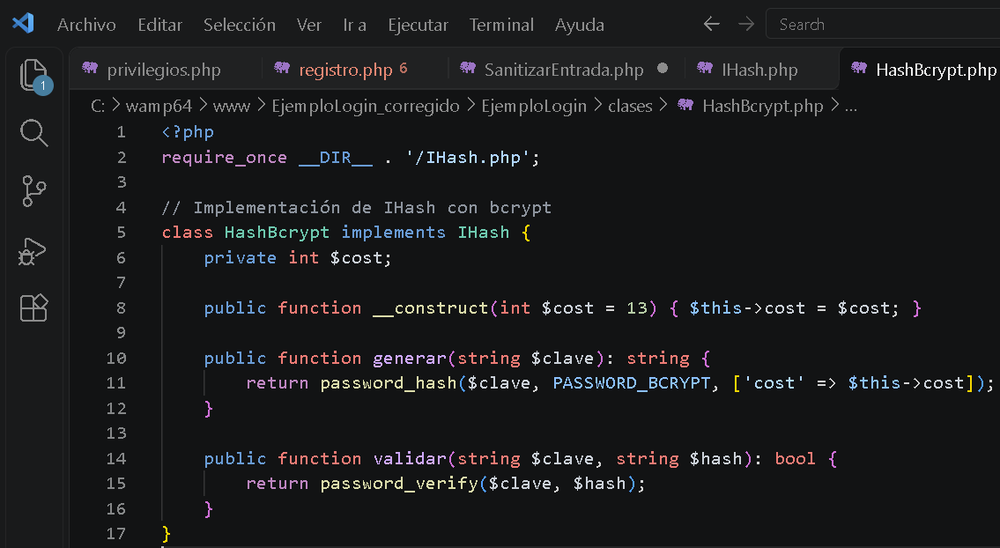

## 10. Protección Anti-CSRF (10 pts)
Clase `Csrf`: genera un token aleatorio (`random_bytes`) guardado en sesión, lo coloca en un campo oculto de cada formulario y lo compara con `hash_equals()` al recibir el POST. Se aplica en login, registro, activación y verificación 2FA.
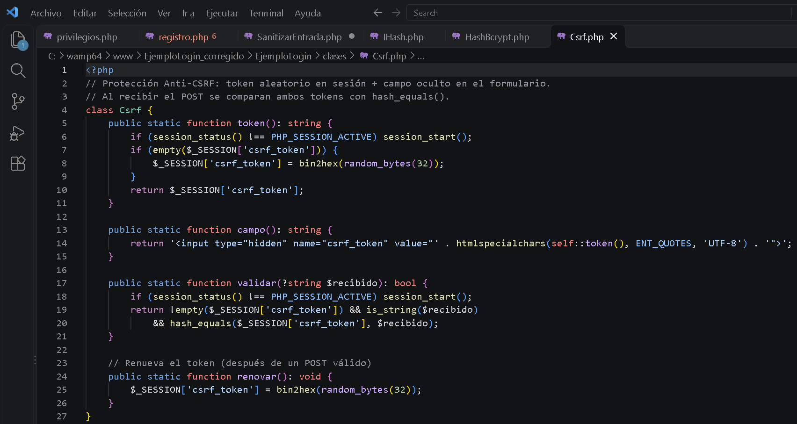

## 11. Tablas que registran datos (10 pts – 5 por tabla)
Tabla `usuarios` (con hash bcrypt y secreto 2FA):
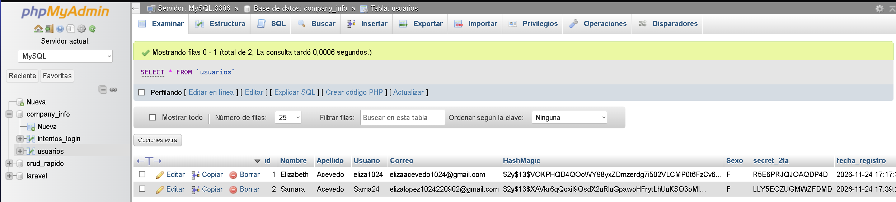

Tabla `intentos_login`:
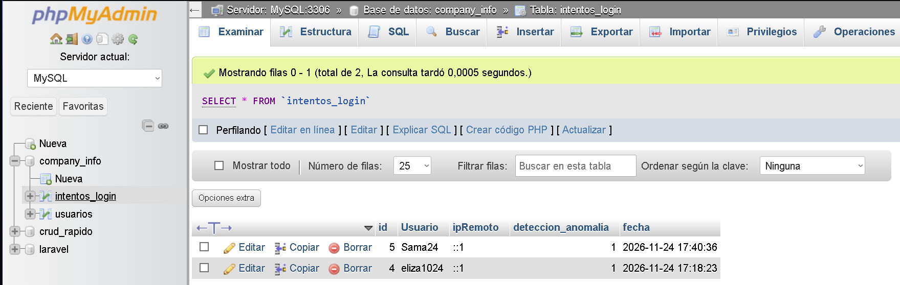

## 12. Calidad del CSS y valor agregado (10 pts)
Diseño unificado en login, registro, QR y verificación (`css/auth.css`), con diseño adaptable a móvil, medidor de fuerza de contraseña, mensajes de validación en tiempo real y retroalimentación de errores (ver capturas 02, 05, 06, 07 y 08).
